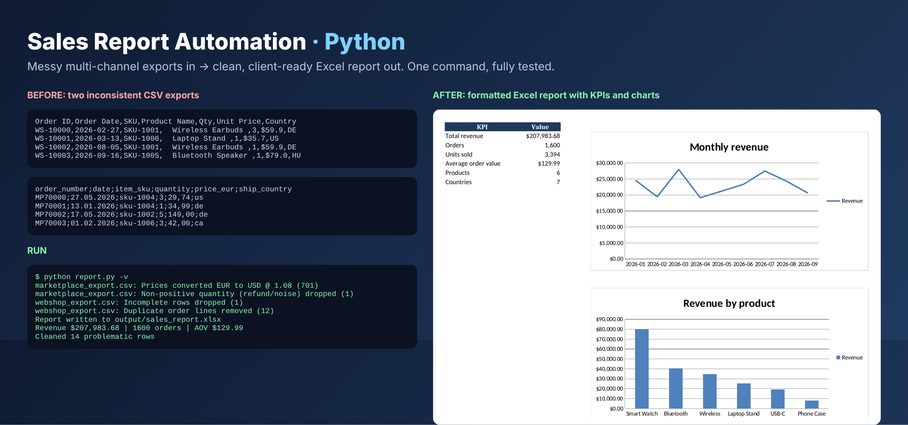

# Sales Report Automation (Python)

Turns messy sales exports from several channels into a clean, client-ready Excel report with one command.



## The problem
Businesses selling on a webshop *and* a marketplace get exports that never match: different column names,
date formats (`2026-02-27` vs `27.02.2026`), decimal separators (`59.90` vs `59,90`), currencies, duplicated
rows, refunds mixed into sales and half-empty lines. Someone usually fixes this by hand in Excel every week.

## What it does
- Detects the CSV separator and maps every known column name to one schema
- Parses mixed date formats and number formats, normalises SKUs and country codes
- Converts EUR-priced sources to USD (`--eur-usd`, default 1.08)
- Removes duplicates, incomplete rows and refunds, and **logs every fix** in a "Data Quality" sheet
- Writes a styled Excel report: KPI summary, monthly trend and product charts, product / country / channel breakdowns, clean data
- Writes a short HTML summary that can be pasted straight into an e-mail

## Run it
```bash
pip install pandas openpyxl
python generate_sample_data.py          # creates two realistic messy exports in sample_data/
python report.py -v                     # -> output/sales_report.xlsx + output/sales_report.html
python -m pytest -q tests               # 4 tests
```

## Tech
Python 3.11+, pandas, openpyxl, pytest. Easy to extend with a scheduler (cron / Windows Task Scheduler),
Google Sheets output, or automatic e-mail delivery.
