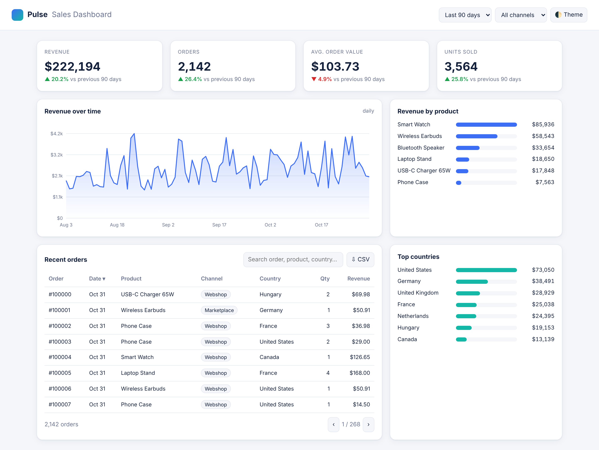

# Pulse: Sales Dashboard (web app)

A fast, responsive analytics dashboard for an online store. Single file, zero dependencies, deploys anywhere
(GitHub Pages, Netlify, any static host). Open `index.html` in a browser to try it.

## Features
- KPI cards (revenue, orders, average order value, units) with change vs the previous period
- Interactive revenue chart with hover tooltip (daily, or weekly for longer ranges)
- Filters: date range (30 / 90 / 365 days) and sales channel; everything updates instantly
- Orders table with search, column sorting, pagination and **CSV export** of the filtered rows
- Revenue by product and by country
- Light / dark theme (remembered), fully responsive down to phone width
- Charts drawn with hand-written SVG: no chart library, loads instantly

Screenshots: `screenshots/` (light, dark, tooltip, mobile) and a short screen recording `dashboard-demo.mp4`.

## Tech
HTML, CSS (custom properties, grid), vanilla JavaScript, SVG. Data is generated with a seeded PRNG so the demo is
reproducible; in a client project it is swapped for a REST/JSON API, a database or a Google Sheet.
