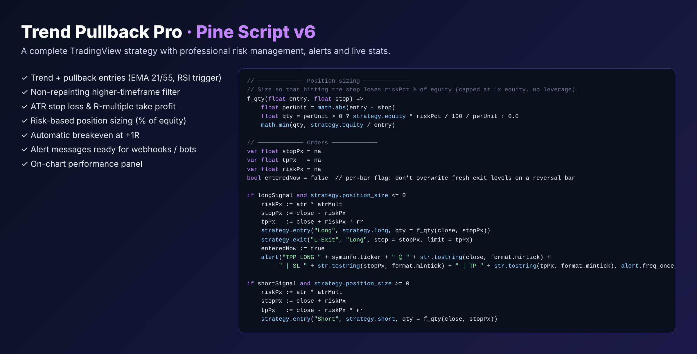

# Trend Pullback Pro (TradingView Pine Script v6)

A complete trend-following strategy for TradingView with professional risk management.

## Logic
- **Trend:** fast EMA (21) above slow EMA (55), price above the slow EMA, and the higher-timeframe (default 4h) close above its EMA
- **Entry:** price pulled back to the fast EMA within the last N bars, then RSI crosses back over 50 (mirror rules for shorts)
- **Exit:** ATR-based stop loss, take profit at a configurable R multiple, optional breakeven at +1R
- **Sizing:** each trade risks a fixed % of equity (default 1%), capped at 1x equity
- **Non-repainting:** the HTF filter only uses confirmed higher-timeframe bars
- **Alerts:** `alert()` messages with ticker, entry, SL and TP, ready for webhooks / trading bots
- **Panel:** closed trades, win rate, profit factor, net profit, max drawdown and current trend on the chart

All parameters are inputs, grouped as Trend / Entry / Risk management / Display.
Commission (0.05%) and slippage are included so backtests are not over-optimistic.

## Use it
TradingView → Pine Editor → paste `trend_pullback_pro.pine` → *Add to chart*.
Results depend on market and timeframe; this is a demonstration of the engineering, not financial advice.
