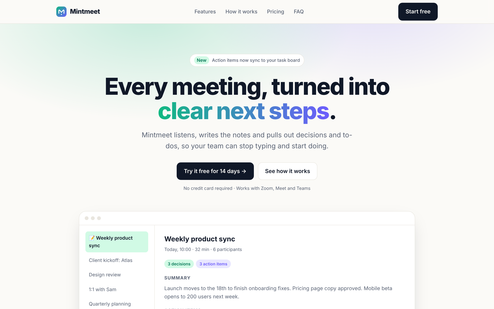

# Mintmeet: SaaS Landing Page (design concept)

A conversion-focused landing page for a fictional AI meeting-notes product. Brand, logo, copy and
testimonials are invented for this design concept.

## What's inside
- Hand-built HTML/CSS, no framework: fast, easy to hand over to any developer or CMS
- Custom SVG logo and icon set
- Hero with product preview, social proof strip, features grid, 3-step "how it works"
- Pricing with monthly / yearly toggle, testimonials, FAQ accordion, sign-up form with validation
- Automatic dark mode (follows the visitor's system setting), fully responsive, respects "reduced motion"
- Accessible markup: semantic sections, labels, `aria-live` form feedback

Screenshots in `screenshots/`: desktop (light and dark), mobile, full page.
Open `index.html` in a browser to try it.

## Tech
HTML5, CSS (custom properties, grid, `color-mix`), a few lines of vanilla JavaScript, Google Font Inter.
