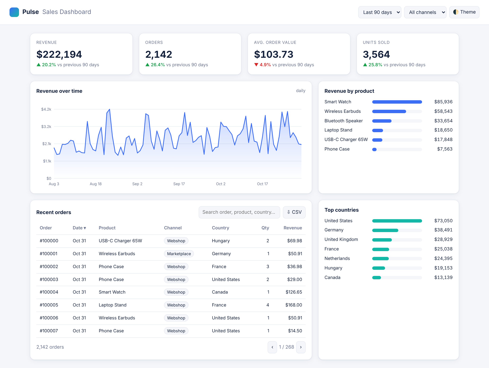

# Gábor Bíró: Portfolio

Python automation, data and web development. Each project is a small, complete and tested piece of work
with its own README and screenshots.

| Project | What it shows | Tech | Live demo |
|---|---|---|---|
| [Sales Report Automation](01-sales-report-automation) | Messy multi-channel CSV exports turned into a formatted Excel report with one command | Python, pandas, openpyxl, pytest | (command-line tool) |
| [Pulse Sales Dashboard](02-sales-dashboard) | Interactive analytics dashboard with filters, charts, search and CSV export | JavaScript, HTML, CSS, SVG | [Open](https://nexusflowindicator.github.io/portfolio/02-sales-dashboard/) |
| [Trend Pullback Pro](03-pine-trend-strategy) | TradingView strategy with ATR risk management, position sizing and alerts | Pine Script v6 | (paste into TradingView) |
| [Mintmeet Landing Page](04-landing-page-design) | Conversion-focused SaaS landing page, custom SVG logo, dark mode | HTML, CSS, JavaScript | [Open](https://nexusflowindicator.github.io/portfolio/04-landing-page-design/) |

## Contact
Available for freelance work on Upwork.
